<picture>
  <source media="(max-width: 600px)" srcset="./assets/profile-mobile.svg">
  
</picture>

<h3><code>suyash@github ~ $ ls projects</code></h3>

 

Also: ClinicGo, a multi-tenant clinic SaaS (Flutter, Next.js, Hono API). Not live.

<h3><code>suyash@github ~ $ ./live.sh</code></h3>

<picture>
  <source media="(max-width: 600px)" srcset="./assets/live-mobile.svg">
  
</picture>

  

<code>$ echo "Open to Summer 2027 software engineering internships."</code>

