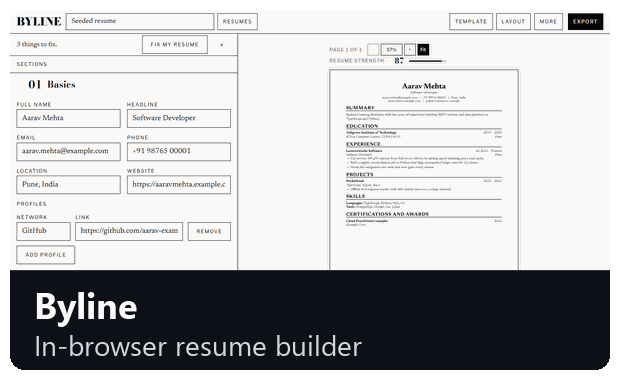
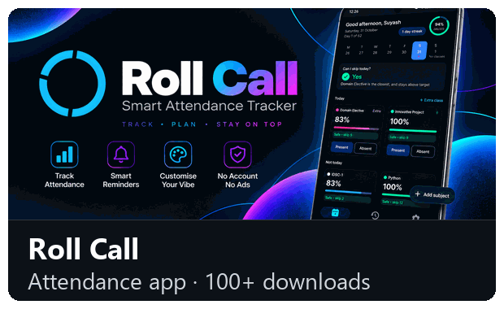
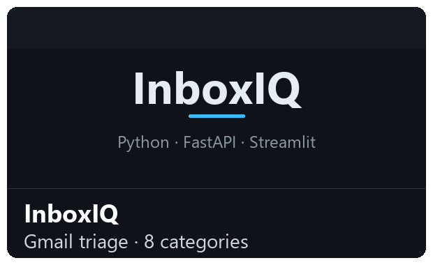
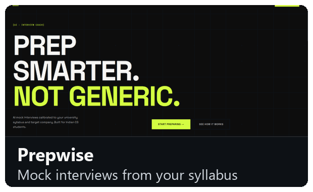
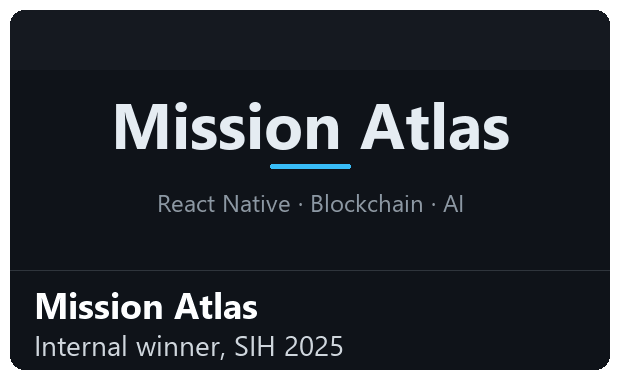
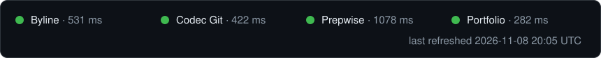

<h1>Suyash Vasal Jain</h1>

Full-stack, Android and applied ML | B.Tech CS&IT, SUAS Indore

<a href="https://suyashvjain.web.app">Portfolio</a> · <a href="https://linkedin.com/in/suyashvasal">LinkedIn</a> · <a href="mailto:suyashvasaljain09@gmail.com">Email</a>

 

I'm a CS student (B.Tech CS&IT, 2024–2028, CGPA 8.94) who builds full-stack products, Android apps and applied ML. I'm President of CODEC, the coding club at my university, and I'm open to Summer 2027 software engineering internships.

<h3>Projects</h3>

<h3>Live</h3>

<picture>
  <source media="(max-width: 600px)" srcset="./assets/live-mobile.svg">
  
</picture>

<h3>Stack</h3>

<h3>Experience</h3>

- **ML Engineer Intern**, Samanviti (Jun–Jul 2026)
- **Full Stack Developer Intern**, I-SoftZone (May–Jul 2025): backend for a multi-branch retail ERP
- **President**, CODEC (2026–present)
- **Chairperson**, ACM SUAS (2025–26)
- **Membership Development Chair**, IEEE SUAS (2026–present)
