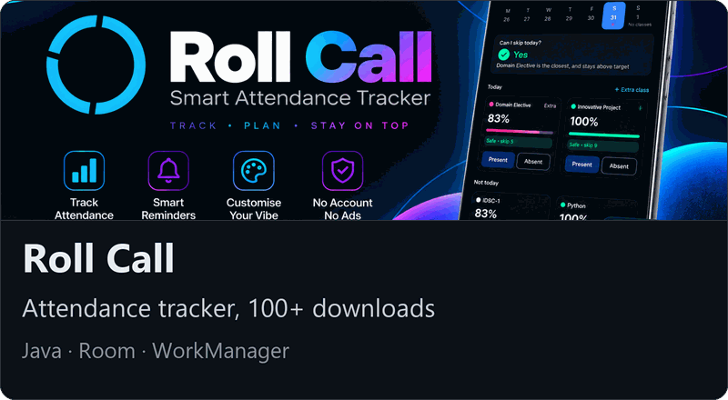
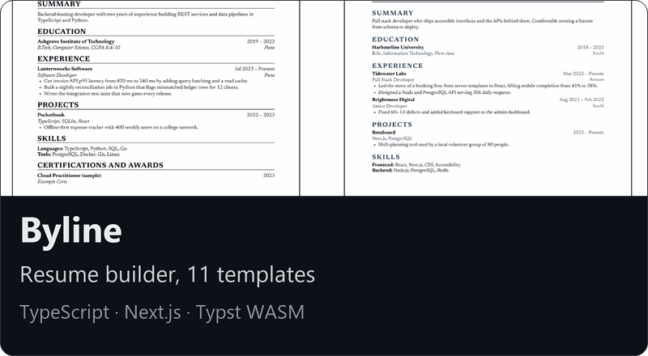
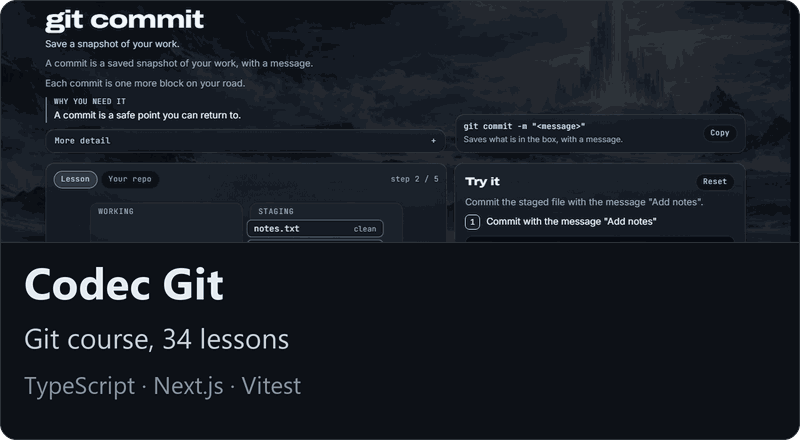
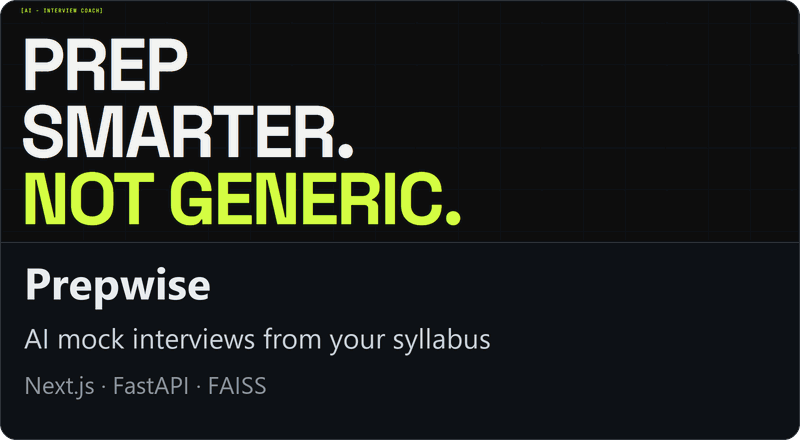

B.Tech CS&IT at SUAS Indore (CGPA 8.94) · President of CODEC · Open to Summer 2027 internships.

<b>100+</b> Play Store downloads · <b>267</b> unit tests · <b>34</b> Git lessons · <b>11</b> resume templates · <b>5,888</b> emails classified

### Projects

 

Also: InboxIQ (Gmail triage, 86.8% accuracy at 0.12 ms per email) and [Mission Atlas](https://github.com/yashordK/Mission-Atlas-SIH-) (tourist safety).

### Experience and highlights

- Machine Learning Intern, Samanviti (Jun–Jul 2026)
- Full Stack Intern, I-SoftZone (May–Jul 2025): backend for a multi-branch retail ERP
- President, CODEC Coding Club (2026–present); ACM Student Chapter Chairperson, SUAS (2025–26); IEEE SUAS Membership Development Chair (2026–present)
- Smart India Hackathon 2025: internal round winner (Mission Atlas)
- Symbiosis Skill Hackathon 2026: consolation prize
- MSME Idea Hackathon 6.0: college-selected idea (ClinicGo)

### Stack

TypeScript · JavaScript · Python · Java · React · Next.js · Node.js · FastAPI · Flutter · Supabase
