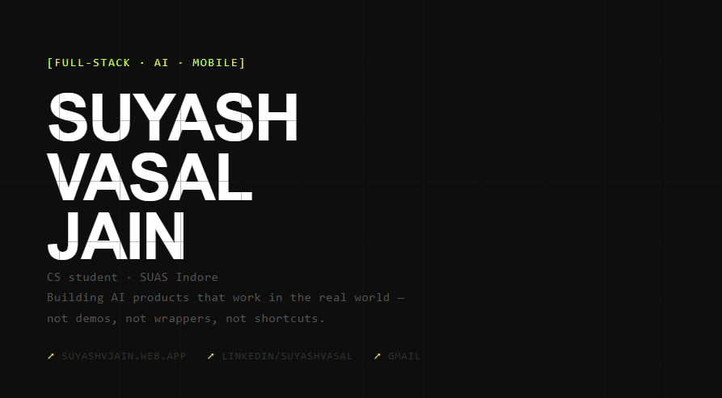

&nbsp;
&nbsp;

---

B.Tech CS&IT student at SUAS Indore (batch 2024–2028, CGPA 8.94). I build full-stack products, mobile apps and applied ML, and I care about the unglamorous parts: tests, trade-offs and being honest about what a system can and can't do.

Backend work on a live retail ERP, a Play Store app with 100+ downloads, and a few tools I built because I wanted them to exist. I also lead the coding club at my university and teach what I learn.

---

## Selected Work

### [Byline](https://github.com/SuyashVJain/byline) - Free LaTeX-style Resume Builder
> A resume builder that never sends your data anywhere.

11 templates, 5 export formats, PDF and DOCX import, resume score, JD match and a readability check. Typst compiles to WebAssembly in the browser, so it works offline, and an end-to-end test checks that nothing leaks over the network (strict CSP).

`TypeScript` `WebAssembly (Typst)` `Playwright` `Offline-first`

---

### [Codec Git](https://github.com/SuyashVJain/codecgit) - Learn Git in the Browser
> 34 lessons, 6 levels, no install.

An interactive Git course with an in-browser Git simulation (tested with Vitest), a sandbox, quizzes and a cheat sheet. I built it for the sessions I teach to first-year students.

`TypeScript` `Vitest` `Static site` `ESLint + Prettier`

---

### Roll Call - Attendance Tracker (Play Store)
> 100+ downloads. Built, tested and shipped solo.

Flutter attendance app for college students with .xlsx import, 3 home-screen widgets, 267 tests and a versioned local schema (11 → 14).

`Flutter` `Drift` `SQLite` `Android widgets`

---

### [InboxIQ](https://github.com/SuyashVJain) - Gmail Triage Assistant
> Faster model, slightly less accurate, and I can tell you exactly by how much.

Classifies 5,888 emails into 8 categories. The model I shipped scores 86.8% at 0.12 ms per email, against 87.5% at 1.6 ms for the best alternative: 13x slower for a 0.7-point gain. Streamlit dashboard, Neon backend.

`Python` `scikit-learn` `Streamlit` `Neon`

---

### [Prepwise](https://prepwise-mocha.vercel.app) - AI Mock Interview Platform
Upload a syllabus PDF and the AI coach interviews you on what you studied, using a real RAG pipeline with semantic retrieval, scoring and weak-topic tracking.

`Next.js` `FastAPI` `Groq (Llama 3.3 70B)` `FAISS` `Supabase`

**[Live demo](https://prepwise-mocha.vercel.app)** · **[Source](https://github.com/SuyashVJain/prepwise)**

---

### [Mission Atlas](https://github.com/yashordK/Mission-Atlas-SIH-) - Tourist Safety Platform `SIH 2025 · Internal Winner`
Built with a teammate for Smart India Hackathon 2025: blockchain-verified identity, real-time SOS alerts, GPS sharing and an AI itinerary planner.

`React Native` `Blockchain` `AI` `Real-time GPS`

---

Also: **[Neural Learn](https://github.com/SuyashVJain/NeuralVoid)** (offline AI tutor, local Gemma 3 + FAISS in Flutter) and **[VahanVault](https://github.com/SuyashVJain/vahan_vault)** (offline-first vehicle document manager with biometric lock).

---

## Experience

- **ML Engineer Intern, Samanviti** (Jun–Jul 2026): the InboxIQ work above
- **Full Stack Developer Intern, I-SoftZone** (May–Jul 2025): backend for a multi-branch retail ERP
- **President, CODEC Coding Club** (Sep 2026–present) · **Chairperson, ACM SUAS** (2025–26) · **Membership Development Chair, IEEE SUAS** (2026–present)

---

## Stack

| | |
|---|---|
| **Languages** | TypeScript · JavaScript · Python · Java · C · SQL |
| **Frontend** | React · Next.js · Tailwind CSS |
| **Backend** | Node.js · Express.js · FastAPI |
| **Mobile** | Flutter · React Native · Android (Java) |
| **AI / ML** | RAG · FAISS · scikit-learn · PyTorch · Ollama · Local LLMs · Groq |
| **Databases** | MySQL · Supabase · SQLite · Firebase |
| **Tools** | Git · Vitest · Playwright · Figma · Postman |

---

## Currently

- Maintaining Byline and Codec Git
- Looking for Summer 2027 software engineering internships
- Leading CODEC's sessions and a flagship project for first-years

---

## Beyond the code

Dancing, music and design. I spend time on UI/UX and occasionally help with branding for campus events.

---

*Open to internships, collaborations and products worth building.*

