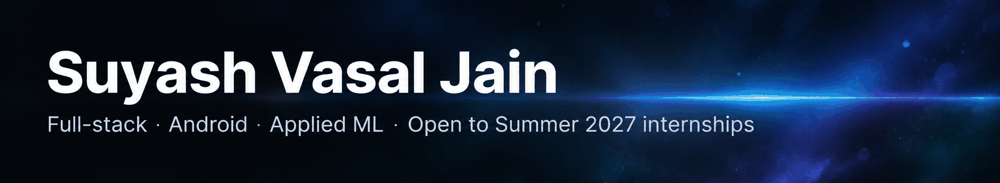
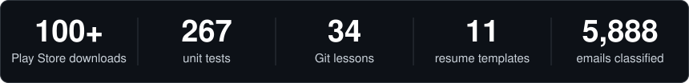

 

CS student at SUAS Indore. President of CODEC. Open to Summer 2027 software engineering internships.

 

<picture>
  <source media="(max-width: 600px)" srcset="./assets/numbers-mobile.svg">
  
</picture>

  

<h3>Projects</h3>

Also: InboxIQ (Gmail triage, 8 categories), <a href="https://github.com/yashordK/Mission-Atlas-SIH-">Mission Atlas</a> (SIH 2025 internal winner).

  

<h3>Experience</h3>

- **ML Engineer Intern**, Samanviti (Jun–Jul 2026)
- **Full Stack Developer Intern**, I-SoftZone (May–Jul 2025)
- **President**, CODEC · **ACM SUAS** Chairperson · **IEEE SUAS** Membership Development Chair

  

<h3>Stack</h3>

