  

<a href="https://suyashvjain.web.app">suyashvjain.web.app</a> ·
<a href="https://linkedin.com/in/suyashvasal">linkedin.com/in/suyashvasal</a> ·
<a href="mailto:suyashvasaljain09@gmail.com">suyashvasaljain09@gmail.com</a>

<h3><code>suyash@github ~ $ cat building.txt</code></h3>

<h3><code>suyash@github ~ $ ls projects</code></h3>

<a href="https://github.com/SuyashVJain/Roll_Call">GitHub</a> · <a href="https://play.google.com/store/apps/details?id=com.suyash.rollcall">Play Store</a>

<a href="https://github.com/SuyashVJain/inboxiq">GitHub</a>

<a href="https://github.com/yashordK/Mission-Atlas-SIH-">GitHub</a>

<a href="https://github.com/SuyashVJain/prepwise">GitHub</a> · <a href="https://prepwise-mocha.vercel.app">Live</a>

<a href="https://github.com/SuyashVJain/byline">GitHub</a> · <a href="https://byline-res.vercel.app">Live</a>

<a href="https://github.com/SuyashVJain/codecgit">GitHub</a> · <a href="https://codecgit.vercel.app">Live</a>

 

Also: <a href="https://github.com/SuyashVJain/clinicgo2">ClinicGo</a>, a multi-tenant clinic SaaS (Flutter, Next.js, Hono API). Not live.

<h3><code>suyash@github ~ $ cat experience.txt</code></h3>

<b>ML Intern</b>, Samanviti (Jun–Jul 2026) 
<b>Full Stack Intern</b>, I-SoftZone (May–Jul 2025): backend for a multi-branch retail ERP 
<b>President</b>, CODEC (2026–present) 
<b>Chairperson</b>, ACM SUAS (2025–26) 
<b>Membership Development Chair</b>, IEEE SUAS (2026–present)

<h3><code>suyash@github ~ $ ./status.sh</code></h3>

<h3><code>suyash@github ~ $ ./contributions</code></h3>

<h3><code>suyash@github ~ $ ./stats.sh</code></h3>

<h3><code>suyash@github ~ $ ls stack</code></h3>

TypeScript · JavaScript · Python · Java · C · SQL · React · Next.js · Tailwind CSS · Node.js · Express · FastAPI · Flutter · React Native · Android · PyTorch · scikit-learn · RAG · FAISS · Ollama · MySQL · Supabase · SQLite · Firebase · Git · Vitest · Playwright · Figma · Postman

  

<code>$ echo "Open to Summer 2027 software engineering internships."</code>

